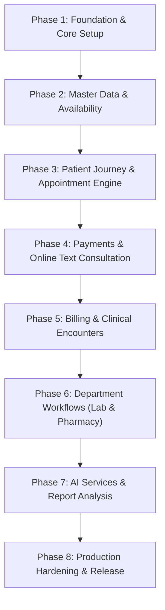

# MediCore — Product Implementation Roadmap & Phase Breakdown

> **Reference Document:** [MediCore_Product_Requirements_Document.md](./MediCore_Product_Requirements_Document.md)  
> **Backend Standards:** [backend-rules/00_index.md](./backend-rules/00_index.md)  
> **UI/UX & Frontend Standards:** [ui-rules/00_index.md](./ui-rules/00_index.md)  
> **Architecture:** Django (Monolith) + HTMX + Alpine.js + Tailwind CSS + PostgreSQL + Redis/Celery

---

## 1. Project Overview & Milestones Summary

To deliver MediCore systematically without sprawling complexity or half-finished modules, development is structured into **8 sequential phases**. Each phase produces a complete, testable vertical slice that complies with the PRD and engineering standards.

---

## Phase 1: Foundation, RBAC & Core UI Shell

**Focus:** Environment setup, secure authentication, role-based authorization, audit logging base, and the global Tailwind + HTMX layout.

### Scope & Tasks
- [x] **Environment & Config:** Configure Django settings (`base.py`, `development.py`, `production.py`) using `python-decouple`.
- [x] **Custom User & Role Model (`apps.accounts`):**
  - Implement `User` model with email login (`Role` choices: Admin, Receptionist, Doctor, Nurse, Lab, Pharmacy, Billing, Patient).
  - Create base profiles (`StaffProfile`, `PatientProfile`).
- [x] **RBAC & Authorization (`FR-01`, `FR-02`):**
  - Implement custom permission classes (`IsAdmin`, `IsDoctor`, `IsReceptionist`, `IsPatient`).
  - Secure object-level ownership checks.
- [x] **Global UI Architecture:**
  - Build `templates/base.html`, `templates/base_auth.html`, `partials/_navbar.html`, `partials/_sidebar.html`, and `partials/_messages.html`.
  - Configure Tailwind CSS v4, DaisyUI, Alpine.js, and HTMX.
- [x] **Audit Logging Base (`apps.audit`, `FR-20`):**
  - Create `AuditEvent` model (`actor`, `action`, `target`, `ip_address`, `timestamp`).
- [x] **Testing:**
  - Unit tests for user creation, role assignment, and password hashing.
  - Integration tests for permission decorators and login/logout flows.

---

## Phase 2: Hospital Master Data & Doctor Availability

**Focus:** Department setup, doctor profiling, and scheduling slot generation rules.

### Scope & Tasks
- [ ] **Hospital & Department Models (`apps.hospital`, `FR-05`):**
  - Models: `Hospital`, `Department`, `Specialty`, `DoctorProfile` (fees, biography, active status).
- [ ] **Doctor Availability & Exceptions (`FR-06`):**
  - Models: `DoctorAvailability` (day of week, shift start/end, slot duration, max patients).
  - Model: `AvailabilityException` (holidays, leaves, custom emergency off-hours).
- [ ] **Admin & Staff Dashboards:**
  - Admin view to manage departments, staff roles, and doctor schedules.
  - Doctor workspace to configure working hours and consultation rates.
- [ ] **Slot Calculation Engine (Selector/Service):**
  - Pure deterministic service to generate available booking intervals based on working hours, breaks, and exceptions.
- [ ] **Testing:**
  - Unit tests for slot generation logic under different shift times and break intervals.
  - Integration tests for admin management views.

---

## Phase 3: Patient Registration & Appointment Engine

**Focus:** Demographic record keeping, duplicate detection, atomic slot booking, and concurrency protection.

### Scope & Tasks
- [ ] **Patient Management (`apps.patients`, `FR-03`):**
  - Model: `Patient` (unique hospital patient number, demographics, contact, emergency contact).
  - Search & duplicate prevention service (checks matching phone numbers/names with warning prompts for receptionists).
- [ ] **Appointment Engine (`apps.appointments`, `FR-07`, `FR-08`):**
  - Model: `Appointment` (`status`: `REQUESTED`, `HELD`, `CONFIRMED`, `CHECKED_IN`, `IN_PROGRESS`, `COMPLETED`, `CANCELLED`, `EXPIRED`, `NO_SHOW`).
  - Model: `SlotHold` (temporary reservation during booking flow).
- [ ] **Concurrency & Slot Locking (`Appendix A.1`, `A.4`):**
  - Database-level unique constraint preventing overlapping confirmed appointments for the same doctor.
  - `select_for_update()` transaction lock during checkout/slot reservation.
- [ ] **HTMX UI Workflows:**
  - Debounced patient search bar for receptionists.
  - Dynamic slot picker for patients with real-time availability updates.
- [ ] **Testing:**
  - Concurrency tests: simulate concurrent booking requests for the same slot (ensure only one succeeds).
  - Tests for appointment cancellation, rescheduling, and receptionist check-in status transitions.

---

## Phase 4: Khalti Payments & 10-Minute Consultation Text Chat

**Focus:** Server-verified payments and WebSocket-powered real-time consultation rooms.

### Scope & Tasks
- [ ] **Payment System (`apps.payments`, `FR-11`):**
  - Model: `Payment` (`PENDING`, `COMPLETED`, `FAILED`, `CANCELLED`, `REFUNDED`).
  - Khalti API test mode client integration: checkout initiation, webhook callback, and server-side verification (`epayment/lookup/`).
  - Idempotent transaction processing (repeated callbacks do not double-confirm bookings).
- [ ] **Consultation Sessions (`apps.consultations`, `FR-09`, `FR-10`):**
  - Model: `ConsultationRoom` (linked to confirmed paid appointment, `start_time`, `end_time`, `is_active`).
  - Model: `ChatMessage` (sender, content, timestamp, delivery status).
  - Model: `ConsultationSummary` (doctor clinical summary before closing).
- [ ] **Real-Time Text Chat with Django Channels + Redis:**
  - WebSocket consumer with authentication enforcing room participation (only assigned doctor and patient).
  - Automatic session timer: countdown display, server-enforced cut-off at 10 minutes, room locks to read-only state.
- [ ] **Testing:**
  - Mock payment provider responses (verification success, signature failure, network timeout).
  - WebSocket connection permission tests and timer termination tests.

---

## Phase 5: Billing, Invoices & Clinical Encounters

**Focus:** Financial transactions, printable invoices, and clinician encounter documentation.

### Scope & Tasks
- [ ] **Billing & Invoices (`apps.billing`, `FR-16`):**
  - Models: `Invoice`, `InvoiceItem` (consultation, tests, procedures, meds), `Receipt`.
  - Automated invoice creation from completed appointments or services.
  - Printable invoice layout (clean CSS print stylesheet).
- [ ] **Clinical Encounters & EMR Records (`apps.patients`, `FR-04`):**
  - Models: `Encounter`, `Allergy`, `PatientHistory`, `ClinicalNote`, `Prescription`, `PrescriptionItem`.
  - Immutable note logging (updates create traceable revisions with doctor ID and timestamp).
- [ ] **Doctor Consultation Workspace:**
  - UI to review past visit notes, record current observations, formulate clinical notes, and draft prescriptions.
- [ ] **Testing:**
  - Tests for invoice balance calculations and line-item totals.
  - EMR access control tests (doctors can only view authorized patients).

---

## Phase 6: Department Workflows — Laboratory & Pharmacy

**Focus:** Diagnostics ordering/verification and atomic pharmacy inventory dispensing.

### Scope & Tasks
- [ ] **Laboratory Management (`apps.laboratory`, `FR-14`):**
  - Models: `LabTest` (catalog with normal reference ranges), `LabOrder`, `LabSample`, `LabResult`, `ResultVerification`.
  - Multi-step status flow: `ORDERED` $\rightarrow$ `SAMPLE_COLLECTED` $\rightarrow$ `PROCESSING` $\rightarrow$ `RESULT_ENTERED` $\rightarrow$ `VERIFIED` $\rightarrow$ `RELEASED`.
  - Lab technician result entry interface with automatic abnormal value highlighting.
  - Patient portal integration for released reports only.
- [ ] **Pharmacy Inventory (`apps.pharmacy`, `FR-15`):**
  - Models: `Medicine`, `Supplier`, `MedicineBatch` (batch number, expiry date, quantity, unit price), `StockMovement`, `Dispense`.
  - Low-stock and near-expiry automated warnings.
  - Atomic dispensing service: deducts from active batch; prevents dispensing expired medicines or negative stock counts.
- [ ] **Testing:**
  - Laboratory verification permission tests (unverified results cannot be seen by patients).
  - Pharmacy concurrency tests: ensure multiple simultaneous dispenses do not corrupt batch inventory.

---

## Phase 7: Guarded AI Services & Async Report Analysis

**Focus:** AI symptom triage guidance, document parsing, and strict safety/privacy boundaries.

### Scope & Tasks
- [ ] **AI Symptom Assistant (`apps.ai_services`, `FR-12`):**
  - Model: `AIConversation`, `AIMessage`.
  - Guarded prompt architecture: includes emergency red-flag detection (chest pain, severe shortness of breath, sudden numbness), disclaimers, and referral to hospital doctors.
  - Explicit instruction refusal: never prescribes dosages, never overrides doctor diagnosis.
- [ ] **Medical Report Upload & Plain-Language Explanation (`FR-13`, `FR-22`):**
  - Private file storage configuration (secure buckets or protected media paths, short-lived signed URLs).
  - Background processing pipeline with Celery + Redis: extract text from PDF/image $\rightarrow$ AI plain-language summarization.
  - Visual distinction between original medical report values and AI explanatory commentary.
- [ ] **Testing:**
  - Unit tests for AI emergency red-flag interception rules.
  - Security tests verifying unauthenticated users cannot access uploaded medical report files.

---

## Phase 8: System Hardening, Notifications & Deployment

**Focus:** Operational notifications, automated background tasks, security auditing, and staging deployment.

### Scope & Tasks
- [ ] **Notifications (`apps.notifications`, `FR-18`):**
  - Model: `Notification` (in-app alerts for appointments, released lab results, payment confirmations).
  - Celery scheduled tasks for appointment reminders (e.g., 2 hours before scheduled slot).
- [ ] **Operational Dashboards (`FR-19`):**
  - Role-specific KPI views (Admin: revenue, admissions; Reception: daily footfall; Doctor: upcoming queue).
- [ ] **Security & Production Hardening:**
  - Run `python manage.py check --deploy`.
  - Configure HTTPS, secure cookies, strict CORS, rate limiting on auth endpoints.
  - Verify database backup and restoration script.
- [ ] **Automated End-to-End Regression Suite:**
  - Full happy-path automated test: Patient registers $\rightarrow$ Books slot $\rightarrow$ Pays test Khalti $\rightarrow$ Enters 10-minute chat $\rightarrow$ Doctor enters prescription $\rightarrow$ Pharmacy dispenses.

---

## Feature Traceability & Dependency Matrix

| Phase | Milestone Name | PRD Requirements | Key Apps Involved |
|---|---|---|---|
| **Phase 1** | Foundation & Core Shell | `FR-01`, `FR-02`, `FR-20` | `accounts`, `audit` |
| **Phase 2** | Master Data & Availability | `FR-05`, `FR-06` | `hospital` |
| **Phase 3** | Patient Journey & Booking | `FR-03`, `FR-07`, `FR-08`, `FR-21` | `patients`, `appointments` |
| **Phase 4** | Payments & Online Consultation | `FR-09`, `FR-10`, `FR-11` | `payments`, `consultations` |
| **Phase 5** | Billing & Clinical Notes | `FR-04`, `FR-16` | `billing`, `patients` |
| **Phase 6** | Lab & Pharmacy Workflows | `FR-14`, `FR-15` | `laboratory`, `pharmacy` |
| **Phase 7** | AI Services & Report Analysis | `FR-12`, `FR-13`, `FR-22` | `ai_services` |
| **Phase 8** | Hardening & Production Release | `FR-18`, `FR-19` | `notifications`, `config` |

