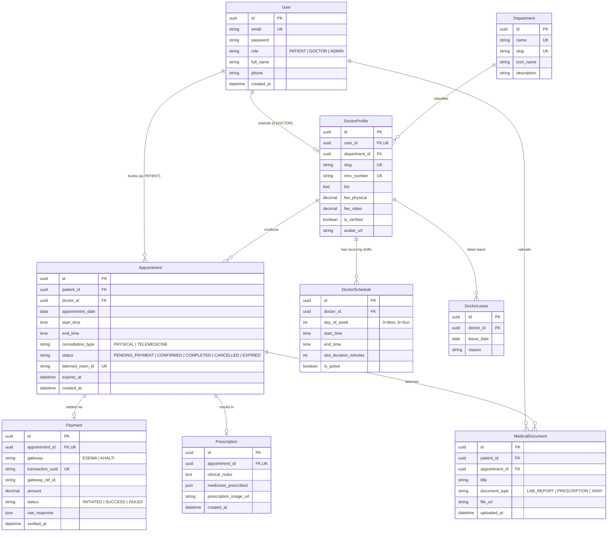
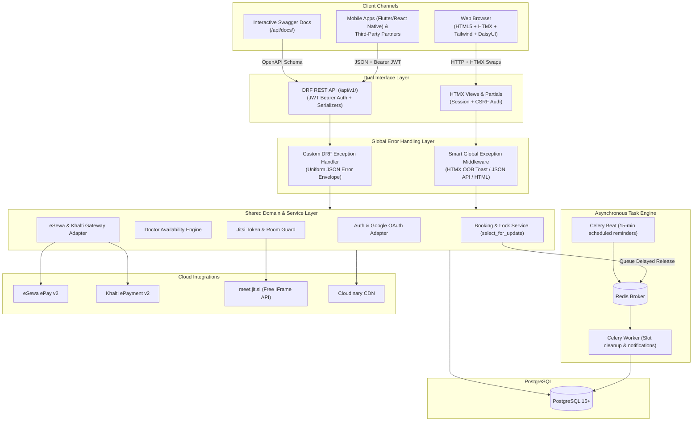

# Swasthya-Sewa (स्वास्थ्य सेवा)
## Complete Project Specification: PRD, Architecture, Data Model & 7-Day Implementation Plan

---

## 1. Executive Summary

**Swasthya-Sewa** is an end-to-end, production-grade Doctor Appointment & Teleconsultation application built for an internship showcase. It follows a **Dual-Engine Architecture**:
1. **Web Interface:** Fast, server-rendered dynamic UI powered by **HTMX + Tailwind CSS + DaisyUI** with zero React/SPA overhead.
2. **REST API Interface:** A decoupled, fully documented RESTful API layer powered by **Django REST Framework (DRF) + Serializers + Swagger / OpenAPI** (`/api/docs/`) for future mobile applications (Flutter/React Native) and third-party healthcare integrations.

### Tech Stack Matrix
* **Backend Core:** Django 5.x (Python 3.11+)
* **REST API Layer:** Django REST Framework (DRF) + `drf-spectacular` (Swagger/OpenAPI UI at `/api/docs/`)
* **Frontend Rendering:** Server-Driven UI with HTMX, Tailwind CSS, DaisyUI (Semantic Prebuilt Components), Alpine.js, Lucide Icons
* **Database:** PostgreSQL 15+ (with atomic row-level concurrency locks `select_for_update`)
* **Distributed Task Queue:** Celery + Redis (Message broker & result backend)
* **Digital Wallets:** eSewa (ePay v2) & Khalti (ePayment v2)
* **Teleconsultation:** Jitsi Meet (IFrame API — 100% free, zero backend WebRTC signaling overhead)
* **Media & Cloud Storage:** Cloudinary (Doctor profile pictures, patient medical history, prescriptions)
* **Authentication:** 
  * **Web (HTMX):** Session-Based Authentication + CSRF Tokens (`HttpOnly` cookies, XSS-immune).
  * **API (DRF):** JWT Authentication (`djangorestframework-simplejwt`, Bearer Tokens).
  * **Social Auth:** Google OAuth2 (`django-allauth`) with strict role-pinning.
* **Identifier Architecture:**
  * **UUIDv4:** All primary keys to prevent IDOR (Insecure Direct Object Reference) attacks and business enumeration.
  * **SLUG:** Public entities (Doctors & Specialties) for SEO-friendly, readable URLs (`/doctors/dr-ramesh-sharma/`).

---

## 2. Product Requirements Document (PRD)

### 2.1 Role-Based Access Control (RBAC)
* **Patient:**
  * Self-registration via email/password or Google OAuth.
  * Search & filter verified doctors by specialty, consultation fee, and consultation type (Physical vs. Video).
  * View doctor availability calendar and real-time open slots.
  * Hold slot with 10-minute temporary lock.
  * Pre-pay consultation fee via eSewa or Khalti to confirm booking.
  * 1-click HD video call entry (Jitsi) for online consultations.
  * Pre-upload medical records (PDF/JPG/PNG) to Cloudinary.
* **Doctor:**
  * **Admin-Provisioned ONLY:** Cannot self-register. Admin creates account with doctor's official email; doctor can subsequently log in with password or matching Google account.
  * Configure recurring weekly shifts (e.g., Sun/Tue/Thu 10:00–14:00, 20-min slots).
  * Mark ad-hoc emergency leave/dates off.
  * View chronological daily patient queue.
  * Conduct video consultations with integrated patient pre-read documents.
  * Issue diagnosis summary and upload prescription slip to Cloudinary.
* **Administrator:**
  * Provision doctor accounts and verify medical licenses (NMC ID).
  * Manage medical departments/specialties.
  * Audit platform financial transactions across eSewa & Khalti.

---

## 3. Data Modeling & Identifier Architecture

### 3.1 Security-Driven Identifier Strategy: UUID vs. SLUG

| Entity | Primary Key (PK) | Slug Field? | Route Example | Security / UX Rationale |
| :--- | :---: | :---: | :--- | :--- |
| **`User`** | **UUIDv4** | ❌ No | `/profile/` | Eliminates user enumeration attacks. |
| **`DoctorProfile`** | **UUIDv4** | ✅ **Yes** | `/doctors/dr-ramesh-sharma/` | Public discovery, SEO-friendly, shareable on social channels. |
| **`Department`** | **UUIDv4** | ✅ **Yes** | `/specialties/cardiology/` | Clean category navigation & search filtering. |
| **`Appointment`** | **UUIDv4** | ❌ No | `/appointments/<uuid>/pass/` | Critical patient privacy; prevents IDOR snooping. |
| **`Payment`** | **UUIDv4** | ❌ No | Internal audit | Collision-proof `transaction_uuid` for eSewa/Khalti. |
| **`Prescription`** | **UUIDv4** | ❌ No | `/prescriptions/<uuid>/` | Medical confidentiality. |
| **`MedicalDocument`** | **UUIDv4** | ❌ No | Direct Cloudinary URL | Secure access guards. |

All models inherit from an abstract base class:
```python
# core/models.py
import uuid
from django.db import models

class BaseModel(models.Model):
    id = models.UUIDField(primary_key=True, default=uuid.uuid4, editable=False)
    created_at = models.DateTimeField(auto_now_add=True)
    updated_at = models.DateTimeField(auto_now=True)

    class Meta:
        abstract = True
```

---

### 3.2 Entity-Relationship (ER) Diagram



---

## 4. Dual-Engine Architecture (HTMX + DRF)

### 4.1 System Overview (C4 Container View)



---

## 5. Global Error Handling Architecture

The application implements a **3-tier global error handling architecture**:
1. **HTMX-Aware Global Exception Middleware:**
   * Detects `HX-Request: true` headers.
   * On unhandled server errors, returns an **Out-of-Band (OOB) Toast Alert** (`hx-swap-oob="beforeend"`) instead of crashing or shoving a full 500 HTML page inside an interactive component.
2. **Standardized DRF Exception Handler:**
   * Transforms all API validation, authentication, and permission errors into a uniform JSON response envelope:
     ```json
     {
       "success": false,
       "error": {
         "status_code": 400,
         "type": "ValidationError",
         "details": { "field_name": ["Specific error message."] }
       }
     }
     ```
3. **Django Root Handlers (`handler400`, `handler403`, `handler404`, `handler500`):**
   * Registered in `config/urls.py` with custom-styled templates matching the Tailwind/DaisyUI theme.

---

## 6. Authentication & Authorization Strategy

### 6.1 Dual-Auth Design
1. **For the Web Application (HTMX):**
   * **Session-Based Authentication with CSRF Tokens.**
   * Uses Django's session cookies marked `HttpOnly` and `SameSite=Lax`.
   * HTMX automatically injects the CSRF token across all requests via `hx-headers='{"X-CSRFToken": "{{ csrf_token }}"}'` on the `<body>` tag.
   * Completely immune to JavaScript XSS token theft.
2. **For the REST API (`/api/v1/`):**
   * **JWT Authentication (`djangorestframework-simplejwt`).**
   * Endpoints: `/api/v1/auth/token/` (Obtain Access + Refresh tokens) and `/api/v1/auth/token/refresh/`.
   * Clients supply `Authorization: Bearer <access_token>` in HTTP headers.
3. **Google OAuth2 Integration (`django-allauth`):**
   * `CustomSocialAccountAdapter` inspects incoming Google verified emails.
   * If the email matches a Doctor account created by Admin $\rightarrow$ Links and grants Doctor dashboard access.
   * If the email is brand new $\rightarrow$ Strictly provisions account with `role = 'PATIENT'`.

---

## 7. Django REST Framework (DRF) Serializers Spec

All API endpoints live under `/api/v1/` and share the exact same underlying service layer as the HTMX views:

| Serializer Name | Purpose | Key Fields |
| :--- | :--- | :--- |
| `DoctorListSerializer` | Serializes doctor directory for mobile/API clients | `id`, `slug`, `full_name`, `department`, `fee_physical`, `fee_video`, `is_verified`, `avatar_url` |
| `DoctorDetailSerializer` | Full doctor profile with working hours | `DoctorListSerializer` fields + `bio`, `years_of_experience`, `schedules` |
| `SlotAvailabilitySerializer` | Serializes open date intervals from Slot Engine | `start_time`, `end_time`, `status (AVAILABLE / HELD / BOOKED)` |
| `AppointmentHoldSerializer` | Validates booking payload from client | `doctor_id`, `date`, `start_time`, `consultation_type` |
| `AppointmentDetailSerializer`| Returns confirmed booking details & room token | `id`, `doctor`, `appointment_date`, `start_time`, `status`, `telemed_room_id` |
| `PaymentVerifySerializer` | Validates incoming eSewa/Khalti signatures | `gateway`, `transaction_uuid`, `pidx`, `signature`, `amount` |

---

## 8. Key Engineering Invariants & Protections

1. **Zero Double-Booking Invariant:**
   * Handled by PostgreSQL row-level locks (`SELECT FOR UPDATE`) within `transaction.atomic()`. Any colliding request receives an immediate HTTP 409 conflict.
2. **Payment Idempotency:**
   * Gateway callbacks verify internal transaction UUIDs (`transaction_uuid`) with a unique database constraint. Redundant webhook calls do not cause double confirmation.
3. **Automatic Abandoned Slot Recovery:**
   * If a patient closes the tab during payment, a Celery delayed task (`countdown=600`) verifies if payment succeeded. If still `PENDING_PAYMENT`, it marks the appointment `EXPIRED` and frees the slot.
4. **Teleconsultation Security:**
   * Meeting rooms are generated with cryptographically unguessable room identifiers (`hmac-sha256`). Rooms are accessible only to the participating doctor and patient within 15 minutes of the scheduled time.

---

## 9. 7-Day Implementation Roadmap Summary

* **Phase 0:** Environment, Scaffolding, PostgreSQL, Redis, Django, HTMX, DaisyUI, DRF.
* **Phase 1:** Dual Auth (Session/CSRF for Web + SimpleJWT for API), Custom User (UUID PK), Google OAuth, Global Error Middleware.
* **Phase 2:** Doctor Domain (UUID PK + Slug), Weekly Schedules, Leave Overrides, Pure Python Slot Engine.
* **Phase 3:** Patient Discovery, Dynamic HTMX Slot Picker & DRF Slot Endpoints.
* **Phase 4:** eSewa & Khalti Integrations, Atomic Slot Lock (`select_for_update`), Payment Callbacks.
* **Phase 5:** Jitsi Meet Video Call Embedding, Access Guards, Cloudinary Medical File Uploads.
* **Phase 6:** Celery & Redis Task Engine, 10-Minute Slot Auto-Release, Periodic Reminder Scheduler.
* **Phase 7:** Doctor Queue Desk, Prescription Editor, Swagger / OpenAPI Docs (`/api/docs/`), Seed Script.
