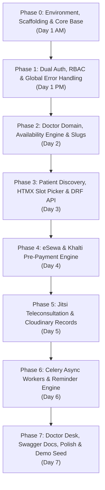

# Swasthya-Sewa (स्वास्थ्य सेवा)
## Phase-Wise Implementation Roadmap & Technical Execution Plan

**Project Type:** Production-Grade Healthcare Appointment & Teleconsultation Platform  
**Target Timeline:** 7 Days (Structured into 8 Executable Phases)  
**Architecture:** Dual-Engine (HTMX Server-Driven Web UI + DRF REST API with Swagger Docs)  
**Security & Identifiers:** UUIDv4 Primary Keys for all sensitive models + SEO Slugs for public profiles  

---

## Roadmap Executive Summary



---

## Phase Matrix at a Glance

| Phase | Title | Timeline | Core Tech Involved | Key Deliverable |
| :---: | :--- | :---: | :--- | :--- |
| **0** | **Environment & Core Foundation** | Day 1 (AM) | Python 3.11, PostgreSQL 15, Redis, Django 5, Tailwind, DaisyUI | Local environment, base templates, Docker Compose |
| **1** | **Identity, RBAC & Dual Auth** | Day 1 (PM) | Django Auth, `django-allauth` (Google), SimpleJWT, UUIDv4 | Session/CSRF for Web, JWT for API, role-pinned Google login |
| **2** | **Doctor Domain & Slot Engine** | Day 2 | Django ORM, Pure Python, Slugs, DRF Serializers | Shift chunking algorithm, weekly availability, leave overrides |
| **3** | **Patient Discovery & Booking UI** | Day 3 | HTMX, DaisyUI, PostgreSQL `SELECT FOR UPDATE` | Live debounced search, dynamic slot grid, 10-min atomic hold |
| **4** | **Payment Gateways (eSewa & Khalti)** | Day 4 | HMAC-SHA256, Khalti API v2, Idempotency keys | Pre-appointment payment enforcement, callback verification |
| **5** | **Teleconsultation & Cloudinary** | Day 5 | Jitsi Meet IFrame API, Cloudinary SDK | In-browser encrypted video call, medical report uploads |
| **6** | **Celery Async & Reminder Engine** | Day 6 | Celery, Redis Broker, Celery Beat, SMTP | 10-min slot auto-release, 15-min periodic reminder alerts |
| **7** | **Doctor Desk, Swagger UI & Polish** | Day 7 | `drf-spectacular`, Alpine.js, Seed Script | Doctor queue dashboard, interactive Swagger docs, seed demo |

---

## Detailed Phase Breakdown

---

### Phase 0: Environment, Scaffolding & Core Base
**Timeline:** Day 1 (Morning)  
**Objective:** Establish a clean, reproducible development environment with PostgreSQL, Redis, Django, Tailwind CSS, and DaisyUI.

#### Technical Tasks
1. **Virtual Environment & Dependencies:**
   - Initialize Python virtual environment (`.venv`).
   - Create `requirements.txt` containing:
     - `django>=5.0`, `djangorestframework`, `djangorestframework-simplejwt`, `drf-spectacular`
     - `psycopg2-binary`, `celery`, `redis`, `django-allauth`
     - `cloudinary`, `requests`, `python-dotenv`
2. **Docker Compose (`docker-compose.yml`):**
   - Service 1: `postgres` (PostgreSQL 15, Port `5432`)
   - Service 2: `redis` (Redis 7 Alpine, Port `6379`)
3. **Domain-Driven App Structure:**
   - `core/` (Abstract base models with UUIDv4, custom middleware, global error views)
   - `accounts/` (Custom User model, roles, Google OAuth adapters, auth views)
   - `doctors/` (Doctor profiles, recurring weekly schedules, leave overrides, slot engine)
   - `appointments/` (Booking service, atomic row locks, appointment state machine)
   - `payments/` (eSewa ePay v2 and Khalti ePayment v2 adapters)
   - `telemed/` (Jitsi Meet video rooms, prescriptions, Cloudinary documents)
   - `api/` (DRF REST API v1 endpoints and serializers)
4. **Base Layout & Frontend Assets:**
   - `templates/base.html` configured with Tailwind CSS CDN, DaisyUI 4 CDN, HTMX 1.9 CDN, and Alpine.js.
   - Configure global CSRF header for HTMX:
     ```html
     <body hx-headers='{"X-CSRFToken": "{{ csrf_token }}"}'>
     ```

#### Definition of Done (DoD)
* Running `python manage.py migrate` executes successfully against PostgreSQL.
* Redis responds to `redis-cli ping` with `PONG`.
* Visiting `http://127.0.0.1:8000/` displays a styled DaisyUI navbar with responsive layout.

---

### Phase 1: Identity, RBAC & Dual Authentication
**Timeline:** Day 1 (Afternoon / Evening)  
**Objective:** Enforce strict role segregation (Admin-only Doctor provisioning, self-serve Patients, Google OAuth + Manual auth, Session for Web + JWT for API).

#### Technical Tasks
1. **Abstract Base Model & Custom User Model (`core/models.py`, `accounts/models.py`):**
   ```python
   class BaseModel(models.Model):
       id = models.UUIDField(primary_key=True, default=uuid.uuid4, editable=False)
       created_at = models.DateTimeField(auto_now_add=True)
       updated_at = models.DateTimeField(auto_now=True)
       class Meta:
           abstract = True

   class User(AbstractUser, BaseModel):
       class Role(models.TextChoices):
           PATIENT = 'PATIENT', 'Patient'
           DOCTOR = 'DOCTOR', 'Doctor'
           ADMIN = 'ADMIN', 'Admin'
       email = models.EmailField(unique=True)
       role = models.CharField(max_length=20, choices=Role.choices, default=Role.PATIENT)
       full_name = models.CharField(max_length=150)
       phone = models.CharField(max_length=20, blank=True, null=True)
       USERNAME_FIELD = 'email'
       REQUIRED_FIELDS = ['username', 'full_name']
   ```
2. **Dual Authentication Setup:**
   - **Web (HTMX):** Standard Django session auth with `HttpOnly`, `SameSite=Lax` cookies.
   - **API (DRF):** SimpleJWT endpoints at `/api/v1/auth/token/` and `/api/v1/auth/token/refresh/`.
3. **Google OAuth Role-Pinning (`accounts/adapters.py`):**
   - Override `DefaultSocialAccountAdapter`:
     - If Google email matches a Doctor account pre-created by Admin $\rightarrow$ Link account and grant Doctor access.
     - If Google email is new $\rightarrow$ Automatically provision as `role = 'PATIENT'`. Never grant Doctor status to unverified Google signups.
4. **Global Error Handling Middleware (`core/middleware.py`):**
   - Inspects `HX-Request`: On uncaught error, returns an out-of-band DaisyUI toast alert (`hx-swap-oob="beforeend"`).
   - Inspects `/api/`: Returns `{ "success": false, "error": {...} }` with status 500.
   - Regular browser: Renders custom `templates/errors/500.html`.
5. **Route Guards & Post-Login Redirection:**
   - Custom decorators: `@doctor_required`, `@patient_required`, `@admin_required`.
   - Unified `/login/` view with Email/Password + "Continue with Google" button.

#### Definition of Done (DoD)
* Patient signs up manually or via Google and lands on `/patient/dashboard/`.
* Admin creates a doctor profile in `/admin/`. The doctor logs in via password or matching Google account and lands on `/doctor/dashboard/`.
* API client can obtain a JWT token from `/api/v1/auth/token/` and query protected API endpoints.
* Unhandled view exceptions in HTMX trigger an out-of-band toast alert without crashing the page layout.

---

### Phase 2: Doctor Domain, Availability Engine & Slugs
**Timeline:** Day 2  
**Objective:** Allow doctors to configure weekly schedules and ad-hoc leaves, and build the pure Python slot calculation engine.

#### Technical Tasks
1. **Doctor Models (`doctors/models.py`):**
   - `Department`: `name`, `slug` (unique), `icon_name`, `description`.
   - `DoctorProfile`: `user` (1-to-1), `department` (FK), `slug` (unique, auto-generated from name), `nmc_number` (unique), `bio`, `fee_physical`, `fee_video`, `is_verified`, `avatar_url`.
   - `DoctorSchedule`: `doctor` (FK), `day_of_week` (0–6), `start_time`, `end_time`, `slot_duration_minutes` (default: 20 min), `is_active`.
   - `DoctorLeave`: `doctor` (FK), `leave_date`, `reason`. Unique on `(doctor, leave_date)`.
2. **Auto-Slug Generation (`doctors/models.py`):**
   - Override `save()` to slugify `dr-{full_name}` with incremental collision suffix (`-1`, `-2`) if names collide.
3. **Pure Python Slot Engine Service (`doctors/services.py`):**
   - `get_available_slots(doctor_id: UUID, target_date: date) -> List[Dict]`:
     1. Verify target date is not in the past.
     2. Query `DoctorLeave`: If found, return `[]` with status `"DOCTOR_ON_LEAVE"`.
     3. Query `DoctorSchedule` for `target_date.weekday()`: If no shift, return `[]` with status `"NOT_SCHEDULED"`.
     4. Generate time intervals from `start_time` to `end_time` incremented by `slot_duration_minutes`.
     5. Query `Appointment` records for `(doctor_id, target_date)` where `status IN ('CONFIRMED', 'PENDING_PAYMENT')`.
     6. Subtract occupied intervals and return a list of slots tagged with status: `AVAILABLE`, `HELD`, or `BOOKED`.
4. **DRF Serializers (`api/serializers.py`):**
   - `DoctorListSerializer`, `DoctorDetailSerializer`, and `SlotAvailabilitySerializer`.
   - Expose `GET /api/v1/doctors/` and `GET /api/v1/doctors/{slug}/slots/?date=YYYY-MM-DD`.

#### Definition of Done (DoD)
* Unit test: A 09:00–10:00 shift with 20-min slots generates 3 slots (`09:00`, `09:20`, `09:40`).
* If an appointment occupies `09:20`, that slot returns status `BOOKED`, while `09:00` and `09:40` remain `AVAILABLE`.
* Visiting `/doctors/dr-ramesh-sharma/` loads the doctor's public profile via its slug.

---

### Phase 3: Patient Discovery, HTMX Slot Picker & DRF API
**Timeline:** Day 3  
**Objective:** Enable patients to search doctors, view dynamic slot availability, and place a 10-minute hold on a slot via HTMX or REST API.

#### Technical Tasks
1. **Live Doctor Search View (`doctors/views.py`):**
   - Input field with debounced HTMX trigger:
     ```html
     <input type="text" name="q" hx-get="" 
            hx-trigger="keyup changed delay:300ms" hx-target="#doctor-grid" hx-swap="innerHTML">
     ```
   - Filters by specialty/department, consultation mode (In-Person vs. Video), and max fee.
2. **Interactive Calendar & Dynamic Slot Grid:**
   - Calendar date click fires `hx-get="?date=YYYY-MM-DD"`.
   - HTMX swaps the `#slot-container` element.
   - If doctor is on leave or not working, render an amber warning alert with clear messaging.
3. **Atomic Slot Reservation Service (`appointments/services.py`):**
   - Wrap reservation in `transaction.atomic()`.
   - Use PostgreSQL pessimistic row locking:
     ```python
     conflict = Appointment.objects.select_for_update().filter(
         doctor=doctor,
         appointment_date=selected_date,
         start_time=selected_time,
         status__in=['CONFIRMED', 'PENDING_PAYMENT']
     ).exists()
     if conflict:
         raise SlotUnavailableError("This slot was just claimed by another user.")
     ```
   - Create `Appointment` with `status = 'PENDING_PAYMENT'`, `expires_at = NOW() + 10m`.
4. **DaisyUI Payment Modal:**
   - On successful hold, return an HTMX response opening the payment modal with eSewa and Khalti buttons and a 10-minute countdown timer.
5. **REST API Booking Endpoint:**
   - `POST /api/v1/appointments/hold/` validated with `AppointmentHoldSerializer`.

#### Definition of Done (DoD)
* Selecting a date updates the slot matrix dynamically without full page reloads.
* Two simultaneous requests for the same slot result in 1 reservation and 1 immediate HTTP 409 conflict error toast.
* API client can hold a slot using `POST /api/v1/appointments/hold/` with a JWT Bearer token.

---

### Phase 4: Pre-Appointment Payment Gateways (eSewa & Khalti)
**Timeline:** Day 4  
**Objective:** Require full consultation fee payment before confirming appointments and issuing clinic passes / video call room access.

#### Technical Tasks
1. **Payment Model (`payments/models.py`):**
   - `appointment` (1-to-1, FK, UUID), `gateway` (`ESEWA`, `KHALTI`), `transaction_uuid` (unique, UUID), `gateway_ref_id` (`pidx` or `refId`), `amount`, `status` (`INITIATED`, `SUCCESS`, `FAILED`), `raw_response` (JSONB).
2. **eSewa ePay v2 Integration (`payments/gateways/esewa.py`):**
   - Generate HMAC-SHA256 signature using eSewa test secret key:
     $$\text{message} = \text{"total\_amount=1000,transaction\_uuid=...,product\_code=EPAYTEST"}$$
   - Render auto-submitting HTML form redirecting to eSewa sandbox (`rc-epay.esewa.com.np`).
   - Callback handler `/payments/esewa/callback/`:
     - Decode returned base64 payload.
     - Validate signature against merchant secret key.
     - Idempotently mark `Payment.status = 'SUCCESS'`, `Appointment.status = 'CONFIRMED'`.
3. **Khalti ePayment v2 Integration (`payments/gateways/khalti.py`):**
   - Server-to-server call: `POST https://a.khalti.com/api/v2/epayment/initiate/` with amount in paisa.
   - Redirect patient to Khalti sandbox payment portal (`payment_url`).
   - Callback handler `/payments/khalti/callback/`:
     - Server-to-server lookup: `POST https://a.khalti.com/api/v2/epayment/lookup/` with `pidx`.
     - Verify status is `Completed`, then mark `Payment.status = 'SUCCESS'`, `Appointment.status = 'CONFIRMED'`.
4. **Post-Payment Confirmation View:**
   - Renders confirmation receipt card:
     - For Physical Visits: Generates clinic pass with appointment code.
     - For Video Consultations: Generates teleconsultation room card.

#### Definition of Done (DoD)
* Completing a test payment on either eSewa or Khalti sandbox transitions the appointment to `CONFIRMED`.
* Refreshing the callback URL does not re-process the payment (idempotency verified).
* Unconfirmed/unpaid appointments cannot enter the teleconsultation room.

---

### Phase 5: Teleconsultation (Jitsi Meet) & Cloudinary
**Timeline:** Day 5  
**Objective:** Free browser-based video calls and cloud-hosted medical records.

#### Technical Tasks
1. **Cryptographic Room Generation (`telemed/services.py`):**
   - On appointment confirmation, generate unguessable room name:
     $$\text{room\_name} = \text{"swasthya-" } + \text{hmac\_sha256}(\text{appointment\_id} + \text{doctor\_id}, \text{SECRET\_KEY})[:24]$$
   - Store in `Appointment.telemed_room_id`.
2. **Security Access Guard (`telemed/views.py`):**
   - View `/appointments/<uuid:id>/video-room/` verifies:
     1. `request.user` is either the booking patient or the assigned doctor.
     2. `appointment.status == 'CONFIRMED'` and `consultation_type == 'TELEMEDICINE'`.
     3. Current time is within the allowed window (e.g. 15 minutes before slot start time).
3. **Embedded Jitsi Meet IFrame Template (`templates/telemed/room.html`):**
   - Embeds `https://meet.jit.si/external_api.js`.
   - Injects user display name (`Dr. [Full Name]` for doctors, `[Full Name]` for patients).
   - Provides native toolbar: Mic, Camera, Chat, Screen Share, Hangup.
4. **Cloudinary Storage Integration (`cloudinary` SDK):**
   - Patient pre-consultation report upload (PDF/JPG/PNG) stored on Cloudinary.
   - Doctor prescription slip upload.

#### Definition of Done (DoD)
* Doctor and patient can join the video room simultaneously directly in the browser.
* Third parties attempting to access the room URL receive an HTTP 403 Forbidden.
* Doctor can view patient-uploaded lab reports side-by-side during the call.

---

### Phase 6: Celery Async Workers & Reminder Engine
**Timeline:** Day 6  
**Objective:** Automate abandoned slot recovery and scheduled appointment reminders.

#### Technical Tasks
1. **Celery Configuration (`config/celery.py`):**
   - Configure Celery with Redis broker and result backend.
2. **Task 1: Delayed 10-Minute Slot Auto-Release (`appointments/tasks.py`):**
   - Enqueued during slot hold: `release_unpaid_slot_task.apply_async(args=[str(appt.id)], countdown=600)`.
   - Task execution logic:
     ```python
     @shared_task
     def release_unpaid_slot_task(appointment_id):
         with transaction.atomic():
             appt = Appointment.objects.select_for_update().get(id=appointment_id)
             if appt.status == 'PENDING_PAYMENT':
                 appt.status = 'EXPIRED'
                 appt.save()
     ```
3. **Task 2: Scheduled Reminders via Celery Beat (`appointments/tasks.py`):**
   - Periodic cron running every 15 minutes.
   - Finds confirmed video consultations starting in the next 30 minutes.
   - Dispatches email alerts to both patient and doctor with direct 1-click room links.
4. **Task 3: Async Transactional Confirmation Email:**
   - Dispatches confirmation receipt email immediately after payment verification.

#### Definition of Done (DoD)
* Holding a slot and abandoning payment results in the slot returning to `AVAILABLE` after exactly 10 minutes.
* Celery Beat logs confirm periodic reminder task execution every 15 minutes.

---

### Phase 7: Doctor Desk, Swagger UI, Polish & Demo Seed
**Timeline:** Day 7  
**Objective:** Build doctor daily queue desk, interactive Swagger documentation, UI polish, and demo seed data script.

#### Technical Tasks
1. **Doctor Daily Queue Dashboard (`doctors/views.py`):**
   - Chronological list of today's patients.
   - HTMX status actions: "Join Video Call", "Mark Completed", "No-Show".
   - In-browser prescription writer (diagnosis, medicines JSON, advice).
2. **Interactive Swagger / OpenAPI Documentation (`api/urls.py`):**
   - Configure `drf-spectacular`:
     - OpenAPI Schema: `/api/schema/`
     - Interactive Swagger UI: `/api/docs/`
3. **Demo Seed Script (`core/management/commands/seed_demo_data.py`):**
   - Single command: `python manage.py seed_demo_data`.
   - Creates:
     - 1 Admin user (`admin@swasthya.com` / `admin123`)
     - 4 Departments (Cardiology, Dermatology, Pediatrics, General Medicine)
     - 3 Verified Doctors with active weekly shifts and auto-generated slugs
     - 2 Test Patients with past medical records
4. **UI Polish & Toast System:**
   - Polished empty states across dashboards.
   - Out-of-band DaisyUI toasts for all HTMX actions.

#### Definition of Done (DoD)
* Running `python manage.py seed_demo_data` populates the database in under 5 seconds.
* Visiting `/api/docs/` loads the Swagger UI where interviewers can test all DRF endpoints live.
* Complete end-to-end user flow functions smoothly from search to video call and prescription.

---

## Post-Completion Portfolio & Interview Preparation

Once all 7 phases are completed, your project demonstrates mastery of:
1. **Full-Stack Competence:** Server-driven UI (HTMX + DaisyUI) + Decoupled REST API (DRF + Swagger).
2. **Fintech Integration:** Real-world payment gateway handling (eSewa HMAC-SHA256 & Khalti API v2) with idempotency.
3. **Distributed Systems:** Celery background workers, delayed tasks (`countdown=600`), and scheduled crons (Celery Beat).
4. **Security & Data Integrity:** Pessimistic locking (`select_for_update`), UUIDv4 primary keys to stop IDOR, and role-pinned OAuth2.
